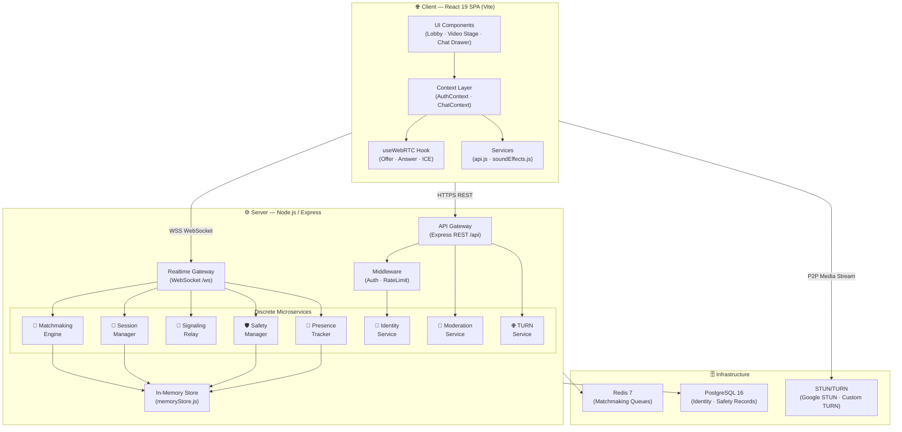
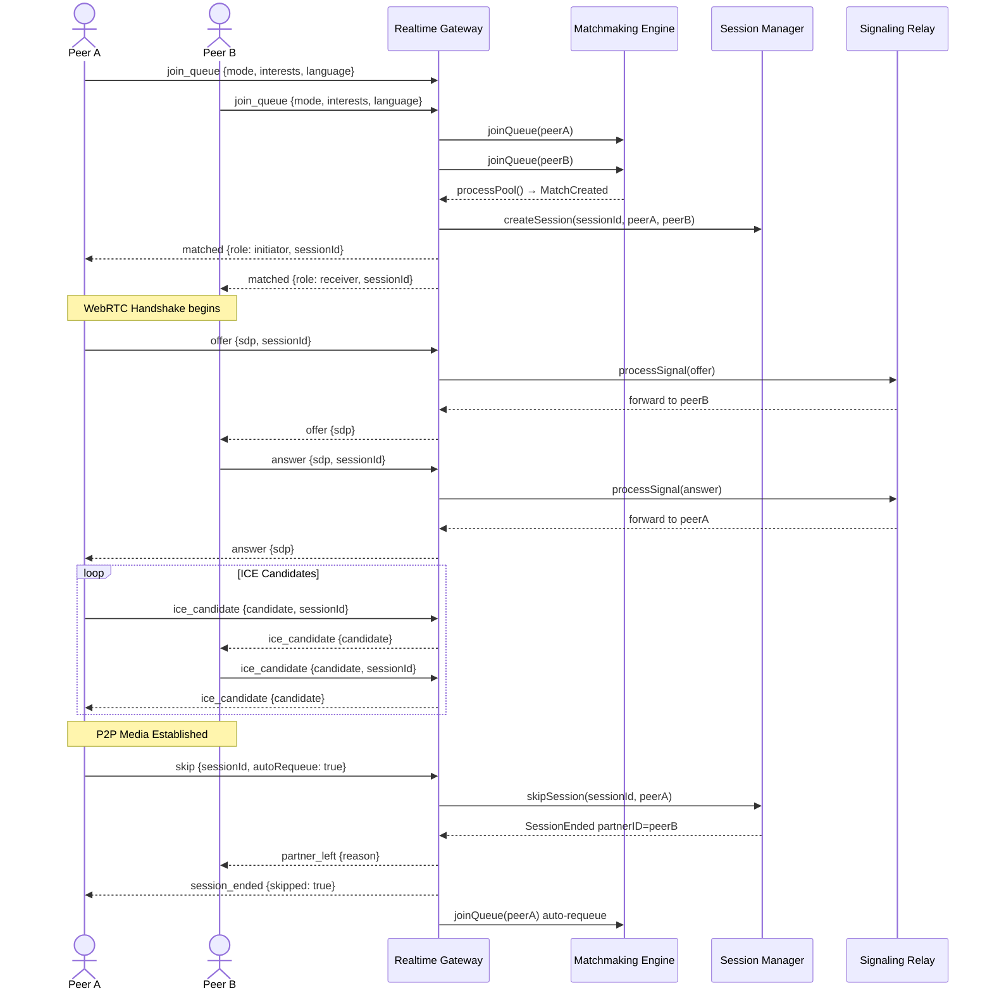
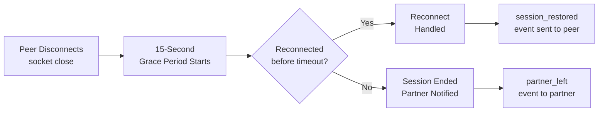
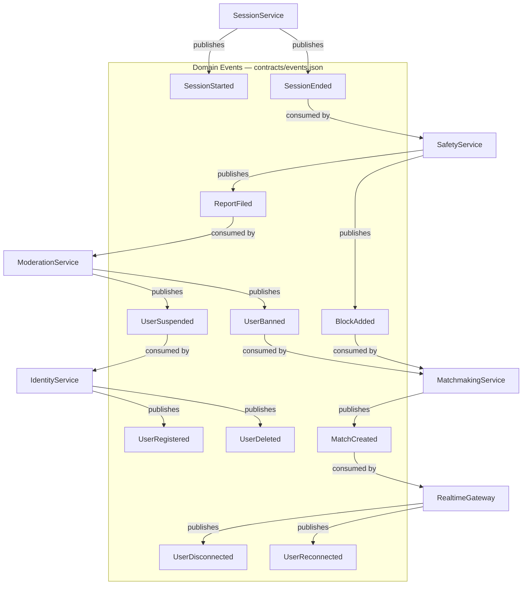

<div align="center">

<h1>
  
</h1>

<p align="center">
  <strong>A modern, privacy-first, open-source Random Video & Text Chat Platform</strong><br/>
  <em>Built with WebRTC · React 19 · Node.js · Express · WebSockets</em>
</p>

<p align="center">
  
  
  
  
  
  
  
  
  
  
  
  
</p>

<p align="center">
  <a href="#-overview">Overview</a> •
  <a href="#-features">Features</a> •
  <a href="#-architecture">Architecture</a> •
  <a href="#-tech-stack">Tech Stack</a> •
  <a href="#-folder-structure">Folder Structure</a> •
  <a href="#-getting-started">Getting Started</a> •
  <a href="#-docker-deployment">Docker</a> •
  <a href="#-environment-variables">Environment Variables</a> •
  <a href="#-api-reference">API Reference</a> •
  <a href="#-websocket-events">WebSocket Events</a> •
  <a href="#-contributing">Contributing</a> •
  <a href="#-license">License</a>
</p>

</div>

---

## 📖 Overview

**P-Omegle** is a high-performance, full-stack random video and text chat platform that connects two strangers peer-to-peer in real time using the [WebRTC](https://webrtc.org/) standard. Inspired by Omegle, it is re-engineered from the ground up with a modern microservice-style backend, robust matchmaking engine, built-in safety/moderation tools, reconnection grace periods, and a premium React-based SPA frontend.

> 💡 **No plugin required.** P-Omegle runs entirely in the browser using native WebRTC APIs and WebSocket signaling — no Flash, no Java, no third-party media servers.

### Why P-Omegle?

| Problem with Legacy Platforms | P-Omegle Solution |
|---|---|
| Centralized media routing (slow, expensive) | True P2P via WebRTC — no media proxy |
| No reconnection after brief drop | 15-second grace period with automatic session restore |
| No interest-based matching | Interest-tag matchmaking with language preference |
| Poor moderation tooling | Built-in moderator dashboard, report & ban system |
| Monolithic, hard to scale | Discrete microservice-style services per domain |
| No auth or persistent identity | JWT-based optional auth with anonymous guest support |

---

## ✨ Features

### 🎥 Core Chat
- **Random Video Chat** — Instant P2P video via WebRTC with camera/mic controls
- **Random Text Chat (Convoo mode)** — Text-only chat with a styled chat interface
- **Interest-Based Matching** — Tag your interests; get matched with like-minded strangers
- **Language Preference** — Filter matches by preferred language
- **Skip & Next** — Instantly skip to the next stranger with optional auto-requeue

### 🔌 Real-Time Infrastructure
- **WebSocket Gateway** — Persistent, low-latency bidirectional messaging (`/ws`)
- **WebRTC Signaling Relay** — Offer/Answer/ICE candidate forwarding between peers
- **In-Call Chat Drawer** — Live text messages during a video session without interruption
- **Typing Indicators** — Real-time `typing_start` / `typing_stop` events
- **Heartbeat & Presence** — Periodic health checks and online presence tracking

### 🛡️ Safety & Moderation
- **Report System** — Users can report partners with reason categorization
- **Block List** — Prevents blocked users from ever being re-matched
- **Moderator Dashboard** — Dedicated UI for reviewing reports, suspending/banning users
- **Rate Limiter** — Per-IP request throttling on all REST and WebSocket endpoints
- **Age Verification** — Registration enforces age ≥ 18

### 🔐 Identity & Auth
- **Optional Authentication** — JWT access tokens (24h) with refresh tokens (7d)
- **Anonymous Guest Mode** — Participate without an account; guest IDs auto-generated
- **Secure Password Hashing** — `bcryptjs` for credential storage
- **Token-Gated WebSocket** — Authenticated sessions carry richer profile data

### ♻️ Resilience
- **Reconnection Grace Period** — 15-second window to restore a dropped session
- **Graceful Shutdown** — SIGTERM/SIGINT handling with connection draining
- **In-Memory Fallback** — Operates without Redis/PostgreSQL for local dev

### 🎨 Frontend Experience
- **Lobby & Video Stage** — Distinct views for waiting and active call states
- **Device Settings Modal** — Switch camera/microphone mid-session
- **Doodle Pad** — Collaborative drawing canvas during chat
- **Sound Effects** — Subtle audio feedback for match/connect events
- **Fully Responsive** — Mobile-first CSS design

---

## 🏗️ Architecture

### High-Level System Overview



---

### Matchmaking & Session Lifecycle



---

### Reconnection Grace Period Flow



---

### Event-Driven Service Communication



---

## 🛠️ Tech Stack

### Frontend

| Technology | Version | Purpose |
|---|---|---|
| [React](https://react.dev/) | `^19.3.1` | UI component framework |
| [Vite](https://vitejs.dev/) | `^8.3.4` | Build toolchain & dev server |
| [@vitejs/plugin-react](https://github.com/vitejs/vite-plugin-react) | `^6.1.2` | Fast Refresh & JSX transform |
| [Lucide React](https://lucide.dev/) | `^1.59.0` | Icon library |
| [WebRTC API](https://webrtc.org/) | Native | P2P video/audio/data channels |
| Vanilla CSS | — | Styling & animations |
| [OxLint](https://oxc.rs/docs/guide/usage/linter.html) | `^1.88.0` | Ultra-fast JavaScript linter |

### Backend

| Technology | Version | Purpose |
|---|---|---|
| [Node.js](https://nodejs.org/) | `24.x` | JavaScript runtime |
| [Express](https://expressjs.com/) | `^4.21.2` | REST API gateway |
| [ws](https://github.com/websockets/ws) | `^8.18.0` | WebSocket server for signaling |
| [jsonwebtoken](https://github.com/auth0/node-jsonwebtoken) | `^9.0.2` | JWT access & refresh tokens |
| [bcryptjs](https://github.com/dcodeIO/bcrypt.js) | `^2.4.3` | Password hashing |
| [cors](https://github.com/expressjs/cors) | `^2.8.5` | Cross-Origin Resource Sharing |
| [dotenv](https://github.com/motdotla/dotenv) | `^16.4.7` | Environment variable management |

### Infrastructure & DevOps

| Technology | Version | Purpose |
|---|---|---|
| [Docker](https://www.docker.com/) | Latest | Container runtime |
| [Docker Compose](https://docs.docker.com/compose/) | `3.8` | Multi-service orchestration |
| [Redis](https://redis.io/) | `7-alpine` | Matchmaking queue store |
| [PostgreSQL](https://www.postgresql.org/) | `16-alpine` | Persistent identity & safety records |
| [Google STUN](https://webrtc.org/) | — | ICE candidate discovery |
| [concurrently](https://github.com/open-cli-tools/concurrently) | `^9.1.2` | Parallel dev server scripts |

---

## 📁 Folder Structure

```
P-Omegle/
│
├── 📄 package.json                  # Root workspace scripts & devDeps (concurrently)
├── 📄 docker-compose.yml            # Multi-service Docker orchestration
├── 📄 .env.example                  # Root environment variable template
├── 📄 .gitignore                    # Git ignore rules
│
├── 📂 contracts/                    # Shared event & API contracts
│   ├── 📄 events.json               # Domain event registry (publisher → consumers)
│   └── 📂 proto/                    # Protobuf schemas (future gRPC)
│
├── 📂 docker/                       # Dockerfiles for each service
│   ├── 📄 Dockerfile.server         # Node.js 24 Alpine image for backend
│   └── 📄 Dockerfile.client         # Nginx-served production client
│
├── 📂 server/                       # Backend — Node.js Microservice
│   ├── 📄 package.json              # Server dependencies (express, ws, jwt, bcrypt)
│   ├── 📄 .env.example              # Server-specific env template
│   ├── 📄 test-e2e.js               # End-to-end integration test script
│   └── 📂 src/
│       ├── 📄 server.js             # Entry point — HTTP + WebSocket bootstrapper
│       │
│       ├── 📂 config/               # Configuration loaders
│       │   ├── 📄 env.js            # Typed env config with defaults & validation
│       │   └── 📄 iceServers.js     # STUN/TURN server configuration builder
│       │
│       ├── 📂 gateway/              # Protocol gateways
│       │   ├── 📄 apiGateway.js     # Express REST router (auth, moderation, TURN API)
│       │   └── 📄 realtimeGateway.js# WebSocket server — message dispatch & session fanout
│       │
│       ├── 📂 middleware/           # Express middleware chain
│       │   ├── 📄 authMiddleware.js  # JWT verification guard
│       │   └── 📄 rateLimiter.js    # IP-based sliding window rate limiter
│       │
│       ├── 📂 store/                # Data layer
│       │   └── 📄 memoryStore.js    # In-process Map store (falls back from Redis/PG)
│       │
│       └── 📂 services/             # Discrete domain services
│           ├── 📂 identity/         # User auth & account management
│           │   ├── 📄 identityService.js  # Register, login, delete account
│           │   └── 📄 tokenUtils.js       # JWT sign / verify helpers
│           │
│           ├── 📂 matchmaking/      # Peer pairing engine
│           │   └── 📄 matchmakingEngine.js# Interest-weighted queue processing
│           │
│           ├── 📂 session/          # Active chat session lifecycle
│           │   └── 📄 sessionManager.js   # Create, skip, heartbeat, grace period
│           │
│           ├── 📂 signaling/        # WebRTC message relay
│           │   └── 📄 signalingRelay.js   # Validate & forward offer/answer/ICE
│           │
│           ├── 📂 presence/         # Online status tracking
│           │   └── 📄 presenceTracker.js  # Register / unregister socket presence
│           │
│           ├── 📂 safety/           # Report & block system
│           │   └── 📄 safetyManager.js    # File reports, manage block list
│           │
│           ├── 📂 moderation/       # Admin enforcement
│           │   └── 📄 moderationService.js# Suspend & ban offending accounts
│           │
│           └── 📂 turn/             # TURN credential vending
│               └── 📄 turnService.js      # Time-limited TURN token generation
│
└── 📂 client/                       # Frontend — React 19 SPA
    ├── 📄 package.json              # Client deps (react, vite, lucide-react)
    ├── 📄 vite.config.js            # Vite config with React plugin
    ├── 📄 index.html                # HTML shell & meta tags
    ├── 📄 .env.example              # Client-side env template (VITE_*)
    │
    └── 📂 src/
        ├── 📄 main.jsx              # React 19 root mount with StrictMode
        ├── 📄 App.jsx               # Root component — view router (lobby / call)
        ├── 📄 App.css               # App-level layout styles
        ├── 📄 index.css             # CSS reset & root variables
        │
        ├── 📂 context/              # React context providers
        │   ├── 📄 AuthContext.jsx   # Auth state (user, token, login/logout/register)
        │   └── 📄 ChatContext.jsx   # Chat state (view, mode, session, messages)
        │
        ├── 📂 hooks/               # Custom React hooks
        │   └── 📄 useWebRTC.js     # Full WebRTC lifecycle (offer, answer, ICE, streams)
        │
        ├── 📂 services/            # Client-side service adapters
        │   ├── 📄 api.js           # REST client (auth, moderation endpoints)
        │   └── 📄 soundEffects.js  # Audio cues for match / connect events
        │
        ├── 📂 styles/              # Global stylesheet modules
        │   └── 📄 index.css        # Design tokens, utility classes, animations
        │
        ├── 📂 assets/              # Static assets (icons, images)
        │
        └── 📂 components/          # Feature-based UI component tree
            ├── 📂 layout/          # App chrome
            │   └── Navbar.jsx      # Top navigation bar
            │
            ├── 📂 home/            # Landing / home screen
            │
            ├── 📂 lobby/           # Pre-call waiting screen
            │   └── LobbyScreen.jsx # Mode selector, interest input, join queue
            │
            ├── 📂 video/           # Video call stage
            │   ├── LiveVideoStage.jsx    # Full-screen P2P video layout
            │   ├── VideoStage.jsx        # Reusable video grid component
            │   └── ConvooVideoStage.jsx  # Text-mode video variant
            │
            ├── 📂 chat/            # Messaging components
            │   ├── ChatBox.jsx           # Standalone text chat box
            │   ├── ConvooChat.jsx        # Convoo (text-only) mode chat
            │   ├── InCallChatDrawer.jsx  # Slide-out in-call chat overlay
            │   └── ActionControls.jsx    # Skip / Report / Mute controls
            │
            ├── 📂 auth/            # Authentication UI
            │   └── AuthModal.jsx         # Login / Register modal
            │
            ├── 📂 profile/         # User profile management
            │   └── UserProfileModal.jsx  # Edit profile, view stats
            │
            ├── 📂 modals/          # Generic overlay modals
            │   ├── ProModal.jsx          # Premium subscription upsell
            │   └── DeviceSettingsModal.jsx # Camera / mic selector
            │
            ├── 📂 moderation/      # Safety tooling
            │   ├── ModeratorDashboard.jsx # Admin: list reports, take action
            │   └── ReportModal.jsx        # User-facing report filing form
            │
            ├── 📂 doodles/         # Collaborative drawing pad
            │
            └── 📂 common/          # Shared UI primitives
```

---

## 🚀 Getting Started

### Prerequisites

Ensure the following are installed on your machine:

| Tool | Minimum Version | Install |
|---|---|---|
| **Node.js** | `v20 LTS` or `v24+` | [nodejs.org](https://nodejs.org/) |
| **npm** | `v10+` | Bundled with Node.js |
| **Git** | any | [git-scm.com](https://git-scm.com/) |
| **Docker** *(optional)* | `v24+` | [docker.com](https://www.docker.com/) |

---

### 1. Clone the Repository

```bash
git clone https://github.com/Mausam5055/P-Omegle.git
cd P-Omegle
```

---

### 2. Install Dependencies

The project uses **npm workspaces**. A single command installs all packages for both `server` and `client`:

```bash
npm run install:all
```

This is equivalent to:

```bash
npm install                         # Root (concurrently)
npm install --prefix server        # Backend (express, ws, jwt, bcrypt...)
npm install --prefix client        # Frontend (react, vite, lucide-react...)
```

---

### 3. Configure Environment Variables

Copy the example files and fill in your values:

```bash
# Root-level (shared reference)
cp .env.example .env

# Server-specific
cp server/.env.example server/.env

# Client-specific
cp client/.env.example client/.env
```

> See the [Environment Variables](#-environment-variables) section for all available keys and descriptions.

---

### 4. Run in Development Mode

Start the backend and frontend **concurrently** with one command from the project root:

```bash
npm run dev
```

This internally runs:

| Process | Command | URL |
|---|---|---|
| **Server** | `node --watch src/server.js` | `http://localhost:5000` |
| **Client** | `vite` | `http://localhost:5173` |
| **WebSocket** | Auto-started with server | `ws://localhost:5000/ws` |
| **Health Check** | — | `http://localhost:5000/health` |

Or run them individually in separate terminals:

```bash
# Terminal 1 — Backend
npm run dev:server

# Terminal 2 — Frontend
npm run dev:client
```

---

### 5. Open in Browser

Navigate to **[http://localhost:5173](http://localhost:5173)** to use the application.

---

## 🐳 Docker Deployment

The project ships with a complete `docker-compose.yml` that spins up all four services:

| Service | Image | Port | Description |
|---|---|---|---|
| `server` | `docker/Dockerfile.server` | `5000` | Node.js backend + WebSocket |
| `client` | `docker/Dockerfile.client` | `80` | Nginx-served React SPA |
| `redis` | `redis:7-alpine` | `6379` | Matchmaking queue store |
| `postgres` | `postgres:16-alpine` | `5432` | Identity & safety DB |

### Build & Start All Services

```bash
docker-compose up --build
```

### Start in Detached Mode

```bash
docker-compose up -d --build
```

### View Logs

```bash
# All services
docker-compose logs -f

# Backend only
docker-compose logs -f server

# Frontend only
docker-compose logs -f client
```

### Stop All Services

```bash
docker-compose down
```

### Stop & Remove Volumes — destroys persistent data

```bash
docker-compose down -v
```

---

## ⚙️ Environment Variables

### Root / Server Variables (`.env` / `server/.env`)

| Variable | Default | Required | Description |
|---|---|---|---|
| `NODE_ENV` | `development` | ✅ | Runtime environment (`development` / `production`) |
| `PORT` | `5000` | ✅ | HTTP server port |
| `HOST` | `0.0.0.0` | — | Bind address |
| `CLIENT_ORIGIN` | `http://localhost:5173` | ✅ | Primary CORS-allowed origin |
| `ALLOWED_ORIGINS` | `...localhost...` | — | Comma-separated additional allowed origins |
| `JWT_SECRET` | *(change me!)* | ✅ | Secret key for signing access tokens |
| `JWT_EXPIRES_IN` | `24h` | — | Access token TTL |
| `REFRESH_TOKEN_SECRET` | *(change me!)* | ✅ | Secret key for signing refresh tokens |
| `REFRESH_TOKEN_EXPIRES_IN` | `7d` | — | Refresh token TTL |
| `MATCHMAKING_INTEREST_TIMEOUT_MS` | `5000` | — | Time before interest-strict match relaxes |
| `MATCHMAKING_COOLDOWN_MS` | `15000` | — | Cooldown between skip and re-queue |
| `SESSION_GRACE_PERIOD_MS` | `15000` | — | Reconnection window after socket drop |
| `HEARTBEAT_INTERVAL_MS` | `10000` | — | Client heartbeat ping frequency |
| `RATE_LIMIT_WINDOW_MS` | `60000` | — | Rate limiter sliding window (ms) |
| `RATE_LIMIT_MAX_REQUESTS` | `120` | — | Max requests per window per IP |
| `REDIS_URL` | `redis://localhost:6379` | — | Redis connection string (optional) |
| `DATABASE_URL` | `postgresql://...` | — | PostgreSQL connection string (optional) |
| `STUN_SERVERS` | Google STUN | — | Comma-separated STUN URIs |
| `TURN_SERVER_URL` | *(empty)* | — | TURN server URI (production recommended) |
| `TURN_SERVER_USERNAME` | *(empty)* | — | TURN credential username |
| `TURN_SERVER_CREDENTIAL` | *(empty)* | — | TURN credential secret |

### Client Variables (`client/.env`)

| Variable | Default | Description |
|---|---|---|
| `VITE_SERVER_URL` | `http://localhost:5000` | Backend REST API base URL |
| `VITE_WS_URL` | `ws://localhost:5000/ws` | WebSocket signaling endpoint |

> **Security Note:** Never commit `.env` files containing real secrets. The `.gitignore` already excludes them. Always rotate `JWT_SECRET` and `REFRESH_TOKEN_SECRET` in production.

---

## 📡 API Reference

### REST Endpoints (`/api`)

All protected routes require the `Authorization: Bearer <token>` header.

#### Authentication & Identity

| Method | Endpoint | Auth | Description |
|---|---|---|---|
| `POST` | `/api/auth/register` | Public | Create a new account |
| `POST` | `/api/auth/login` | Public | Authenticate and receive tokens |
| `POST` | `/api/auth/refresh` | Public | Exchange refresh token for new access token |
| `DELETE` | `/api/auth/account` | Required | Delete user account and purge data |

#### TURN Credentials

| Method | Endpoint | Auth | Description |
|---|---|---|---|
| `GET` | `/api/turn/credentials` | Optional | Fetch time-limited TURN tokens for ICE |

#### Safety & Moderation

| Method | Endpoint | Auth | Description |
|---|---|---|---|
| `POST` | `/api/safety/report` | Required | File a report against a user |
| `POST` | `/api/safety/block` | Required | Block a user from future matches |
| `GET` | `/api/moderation/reports` | Moderator | List all pending reports |
| `POST` | `/api/moderation/suspend` | Moderator | Suspend an offending user |
| `POST` | `/api/moderation/ban` | Moderator | Permanently ban a user |

#### Health

| Method | Endpoint | Auth | Description |
|---|---|---|---|
| `GET` | `/health` | Public | Server health status & uptime |

---

## 🔌 WebSocket Events

Connect via `ws://localhost:5000/ws?token=<JWT>` (token is optional for guests).

### Client → Server (Actions)

| Action | Payload | Description |
|---|---|---|
| `join_queue` | `{ mode, interests[], language }` | Enter the matchmaking queue |
| `leave_queue` | `{}` | Exit the queue without starting a session |
| `skip` | `{ sessionId, autoRequeue, mode, interests[], language }` | End session, optionally re-queue |
| `offer` | `{ sessionId, sdp }` | Send WebRTC offer SDP to partner |
| `answer` | `{ sessionId, sdp }` | Send WebRTC answer SDP to partner |
| `ice_candidate` | `{ sessionId, candidate }` | Forward ICE candidate to partner |
| `chat_message` | `{ sessionId, text }` | Send in-session text message |
| `typing_start` | `{ sessionId }` | Notify partner typing has begun |
| `typing_stop` | `{ sessionId }` | Notify partner typing has stopped |
| `heartbeat` | `{ sessionId? }` | Keep connection & session alive |

### Server → Client (Events)

| Event | Data | Description |
|---|---|---|
| `connected` | `{ userId, socketId, isGuest }` | Connection acknowledgement |
| `queued` | `{ mode, interests, estimatedWaitMs }` | Confirmed in the matchmaking queue |
| `queue_left` | `{}` | Confirmed queue exit |
| `matched` | `{ sessionId, role, mode, sharedInterests, partnerId }` | Paired with a stranger |
| `session_restored` | `{ sessionId, partnerId }` | Session resumed after reconnect |
| `session_ended` | `{ sessionId, skipped }` | Current session has ended |
| `partner_left` | `{ sessionId, reason }` | Partner disconnected or skipped |
| `partner_reconnected` | `{ sessionId }` | Dropped partner has reconnected |
| `offer` | `{ sdp, ... }` | Forwarded WebRTC offer from partner |
| `answer` | `{ sdp, ... }` | Forwarded WebRTC answer from partner |
| `ice_candidate` | `{ candidate, ... }` | Forwarded ICE candidate from partner |
| `chat_message` | `{ text, senderId }` | Incoming message from partner |
| `typing_start` | `{ senderId }` | Partner started typing |
| `typing_stop` | `{ senderId }` | Partner stopped typing |
| `heartbeat_ack` | `{ timestamp }` | Server heartbeat acknowledgement |
| `error` | `{ message }` | Protocol or validation error |

---

## 🧪 Testing

### End-to-End Integration Test

A standalone E2E test script is included at `server/test-e2e.js`. It simulates two WebSocket clients going through the full flow: connect → queue → match → signaling → skip.

```bash
# Make sure the server is running first
npm run dev:server

# In another terminal
node server/test-e2e.js
```

### Linting (Frontend)

```bash
# Run OxLint on client source
npm run lint --prefix client
```

### Manual Health Check

```bash
curl http://localhost:5000/health
# Response: { "status": "healthy", "timestamp": "...", "uptime": 42 }
```

---

## 🤝 Contributing

Contributions are warmly welcome! Whether it's bug fixes, new features, documentation improvements, or UI polish — all PRs are appreciated.

### Getting Started with Contributing

1. **Fork** the repository on GitHub
2. **Clone** your fork locally:
   ```bash
   git clone https://github.com/<your-username>/P-Omegle.git
   cd P-Omegle
   ```
3. **Create a feature branch** from `main`:
   ```bash
   git checkout -b feat/your-feature-name
   ```
4. **Install dependencies**:
   ```bash
   npm run install:all
   ```
5. **Make your changes** following the code style guidelines below
6. **Test** your changes thoroughly
7. **Commit** using conventional commit format:
   ```bash
   git commit -m "feat(matchmaking): add language preference weighting"
   ```
8. **Push** your branch and open a **Pull Request**:
   ```bash
   git push origin feat/your-feature-name
   ```

---

### Commit Message Convention

We follow the [Conventional Commits](https://www.conventionalcommits.org/) specification:

| Prefix | When to Use |
|---|---|
| `feat:` | A new feature |
| `fix:` | A bug fix |
| `docs:` | Documentation changes |
| `style:` | Code formatting (no logic change) |
| `refactor:` | Code restructuring (no feature/fix) |
| `test:` | Adding or updating tests |
| `chore:` | Build process or tooling changes |
| `perf:` | Performance improvements |

---

### Code Style Guidelines

- **JavaScript**: ES Modules (`import`/`export`) throughout — no CommonJS
- **Frontend**: Functional components only; hooks for all stateful logic
- **Linting**: Run `npm run lint --prefix client` before pushing — no OxLint errors allowed
- **Naming**: camelCase for variables/functions, PascalCase for components/classes
- **Services**: Keep each service focused on a single domain (e.g., no auth logic in matchmaking)
- **Env Variables**: Never hard-code secrets — use `config/env.js` on the server
- **Comments**: Prefer self-documenting code — add JSDoc for public service APIs

---

### Reporting Bugs

Please open a [GitHub Issue](https://github.com/Mausam5055/P-Omegle/issues) with:

- A clear, descriptive title
- Steps to reproduce the bug
- Expected vs. actual behavior
- Your environment (OS, Node.js version, browser)
- Relevant logs or screenshots

---

### Suggesting Features

Open a [GitHub Discussion](https://github.com/Mausam5055/P-Omegle/discussions) or Issue labeled `enhancement` with:

- A description of the problem the feature solves
- Your proposed solution
- Any alternatives you considered

---

## 🗺️ Roadmap

| Status | Feature |
|---|---|
| ✅ Done | P2P WebRTC video & text chat |
| ✅ Done | Interest-based matchmaking |
| ✅ Done | JWT authentication & guest mode |
| ✅ Done | Report / block / moderation system |
| ✅ Done | 15-second reconnection grace period |
| ✅ Done | Docker Compose multi-service stack |
| 🔄 In Progress | Redis-backed persistent matchmaking queues |
| 🔄 In Progress | PostgreSQL schema & ORM integration |
| 📋 Planned | End-to-end encryption for chat messages |
| 📋 Planned | Country / region-based geo-matching |
| 📋 Planned | AI-powered content moderation |
| 📋 Planned | Mobile PWA support |
| 📋 Planned | Collaborative doodle pad (WebSocket canvas sync) |
| 📋 Planned | gRPC inter-service communication (protobuf contracts) |
| 📋 Planned | Horizontal scaling with Redis Pub/Sub fan-out |

---

## 🔒 Security

We take security seriously. If you discover a vulnerability, please **do not open a public issue**. Instead:

1. Email the maintainers (see `package.json` author field)
2. Or open a [GitHub Security Advisory](https://github.com/Mausam5055/P-Omegle/security/advisories/new)

We commit to acknowledging reports within 48 hours and patching critical issues within 7 days.

### Security Checklist for Production Deployment

- [ ] Set strong, random values for `JWT_SECRET` and `REFRESH_TOKEN_SECRET`
- [ ] Restrict `ALLOWED_ORIGINS` to your actual domain(s)
- [ ] Configure a production TURN server (`TURN_SERVER_URL`, credentials)
- [ ] Enable HTTPS / WSS via a reverse proxy (Nginx, Caddy, Cloudflare)
- [ ] Set `NODE_ENV=production`
- [ ] Enable Redis persistence and PostgreSQL backups
- [ ] Review and tighten the rate limiter thresholds

---

## 📄 License

```
MIT License

Copyright (c) 2026 P-Omegle Team

Permission is hereby granted, free of charge, to any person obtaining a copy
of this software and associated documentation files (the "Software"), to deal
in the Software without restriction, including without limitation the rights
to use, copy, modify, merge, publish, distribute, sublicense, and/or sell
copies of the Software, and to permit persons to whom the Software is
furnished to do so, subject to the following conditions:

The above copyright notice and this permission notice shall be included in all
copies or substantial portions of the Software.

THE SOFTWARE IS PROVIDED "AS IS", WITHOUT WARRANTY OF ANY KIND, EXPRESS OR
IMPLIED, INCLUDING BUT NOT LIMITED TO THE WARRANTIES OF MERCHANTABILITY,
FITNESS FOR A PARTICULAR PURPOSE AND NONINFRINGEMENT. IN NO EVENT SHALL THE
AUTHORS OR COPYRIGHT HOLDERS BE LIABLE FOR ANY CLAIM, DAMAGES OR OTHER
LIABILITY, WHETHER IN AN ACTION OF CONTRACT, TORT OR OTHERWISE, ARISING FROM,
OUT OF OR IN CONNECTION WITH THE SOFTWARE OR THE USE OR OTHER DEALINGS IN THE
SOFTWARE.
```

---

## 🙏 Acknowledgements

- [WebRTC.org](https://webrtc.org/) — The open standard powering all P2P communication
- [ws](https://github.com/websockets/ws) — The blazing-fast WebSocket library for Node.js
- [Lucide](https://lucide.dev/) — Beautiful, consistent open-source icons
- [Vite](https://vitejs.dev/) — Next-generation frontend tooling
- [OxLint](https://oxc.rs/) — The fastest JavaScript linter written in Rust

---

<div align="center">

**Made with ❤️ by the P-Omegle Team**

<p>
  <a href="https://github.com/Mausam5055/P-Omegle/issues">🐛 Report Bug</a> •
  <a href="https://github.com/Mausam5055/P-Omegle/issues">✨ Request Feature</a> •
  <a href="https://github.com/Mausam5055/P-Omegle/discussions">💬 Discussions</a>
</p>

</div>
